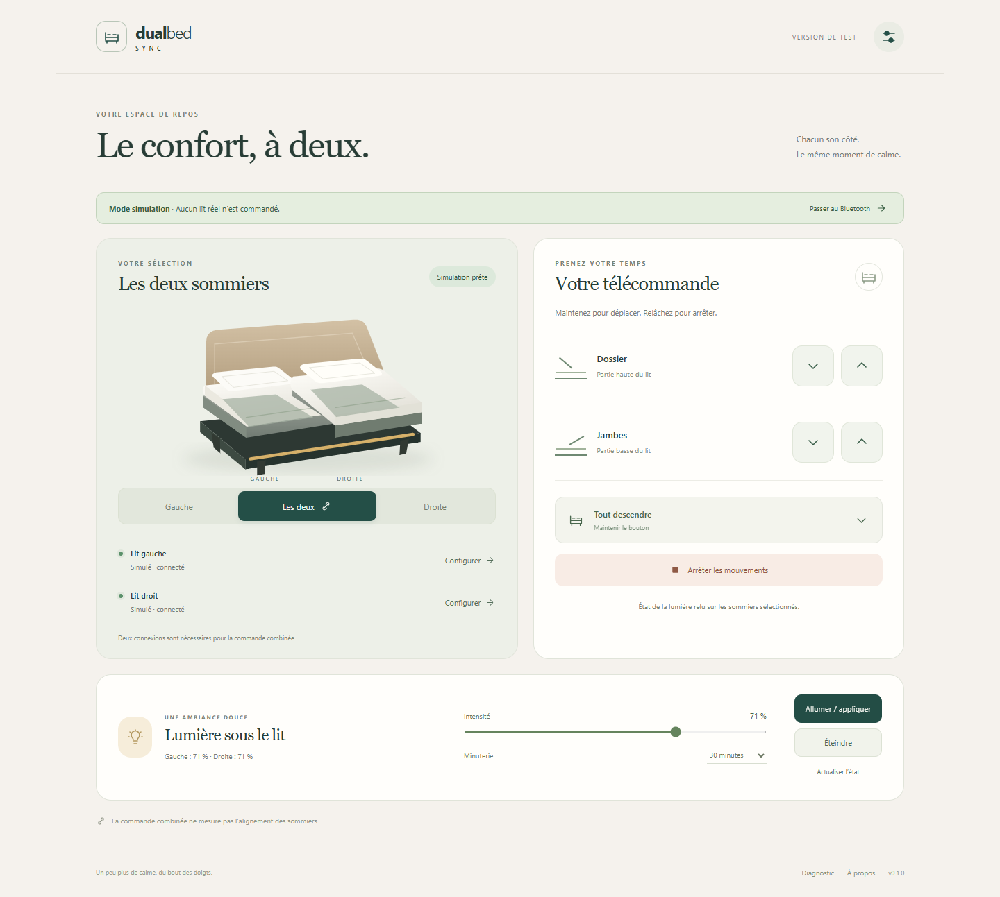

# Dual Bed Sync

Télécommande web pour deux sommiers Vibradorm V-MAT Basic CBI : commande indépendante ou combinée et éclairage sous le lit.

**Version 0.2.0 de test. Les tests logiciels utilisent des transports simulés ; les changements restent à vérifier sur les moteurs réels.**

Dépôt : [theophilebersier/2bedAndroidVibraDorm](https://github.com/theophilebersier/2bedAndroidVibraDorm).

**[Ouvrir l’application en HTTPS](https://theophilebersier.github.io/2bedAndroidVibraDorm/)** — dans Chrome sur Android. Commencer par « Essayer sans connecter de lit », puis suivre la procédure matérielle avant les commandes sur les sommiers.



## Fonctions

- Sélection du lit gauche, droit ou des deux.
- Dossier et jambes : monter/descendre tant que le bouton est maintenu.
- « Tout monter » et « Tout descendre » : les deux zones par maintien, sans estimation de position.
- Attribution gauche/droite mémorisée et reconnexion automatique au retour sur la page.
- STOP au relâchement, annulation tactile, perte de focus ou masquage de la page.
- Commande combinée bloquée tant que les deux sessions ne sont pas prêtes.
- Maintien limité à dix secondes ; relâcher puis maintenir de nouveau pour continuer.
- Éclairage CBI : intensité, minuterie, allumage/extinction et relecture de l’état.
- Simulation explicite, y compris déconnexion d’un côté, sans appel Bluetooth.
- Interface française responsive, contrôle au clavier et mode PWA avec cache de l’interface.
- Diagnostic JSON sans noms ni identifiants d’appareils.

## Démarrer

Prérequis : Node.js 24 ou 26, ou Node 22 à partir de 22.12, et npm.

```sh
npm ci
npm run dev
```

Ouvrir l’URL locale affichée par Vite. Sous PowerShell, employer `npm.cmd` si l’exécution de `npm.ps1` est bloquée.

Le bouton « Essayer sans connecter de lit » permet de parcourir l’application immédiatement. Le mode réel reste le mode initial. Au chargement, seuls les sommiers déjà mémorisés et autorisés peuvent être reconnectés ; aucune commande de mouvement n’est lancée.

Pour construire et prévisualiser la version installable :

```sh
npm run build
npm run preview
```

Servir `dist/` par HTTP local ou HTTPS. Ouvrir directement le fichier `index.html` ne convient pas aux modules et à Web Bluetooth.

## Utiliser les sommiers

1. Sur le téléphone, ouvrir l’application en HTTPS dans Chrome sur Android. Vérifier la présence de Web Bluetooth sur tout autre navigateur.
2. Ouvrir la configuration, conserver « Bluetooth réel », puis choisir le sommier gauche et le droit séparément. Les côtés sont définis en regardant le lit depuis son pied.
3. Confirmer le profil et le comportement de chaque sommier selon la [procédure matérielle](docs/TESTS_MATERIEL.md), avant les essais combinés.
4. Maintenir un bouton de direction. Relâcher pour envoyer STOP. Garder l’application au premier plan et la télécommande d’origine accessible pendant les essais.

La configuration vérifie les services et les propriétés GATT attendus. Un nom Bluetooth ou un modèle lu ne prouve pas à lui seul la compatibilité. La sélection propose les appareils à proximité ; choisir uniquement les récepteurs V-MAT Basic CBI prévus.

L’attribution gauche/droite est conservée localement après une connexion réussie. Lors d’un rechargement, d’un retour sur la page ou d’une perte de liaison au premier plan, l’application retrouve les appareils autorisés par leur identifiant opaque (`navigator.bluetooth.getDevices`) et rétablit les connexions. Elle ne se fie jamais au nom des appareils et n’ouvre pas de sélecteur automatiquement. Les échecs radio donnent lieu à deux nouvelles tentatives espacées ; un nouveau retour sur la page permet de réessayer. Aucun mouvement ne reprend automatiquement.

« Déconnecter » désactive la reconnexion automatique du côté concerné, y compris après rechargement. « Reconnecter » la réactive après une connexion réussie. Si le navigateur ne fournit pas `getDevices`, si les permissions ont été retirées ou si les données locales ont été effacées, il faut renouveler la sélection manuellement. Le mode simulation n’effectue aucune reconnexion réelle. Les tentatives sont suspendues en arrière-plan et pendant une commande.

Après installation de la version 0.2.0, choisir une dernière fois les deux appareils : la version précédente n’enregistrait pas leurs identifiants. Les ouvertures suivantes réutilisent ces choix, tant que le navigateur conserve les données et les autorisations.

## Vérifier

```sh
npm run check
npx playwright install chromium
npm run test:e2e
```

Les tests navigateur lancent un serveur de prévisualisation de `dist/` : construire d’abord avec `npm run build`. Pour utiliser Chrome déjà installé sous PowerShell :

```powershell
$env:PLAYWRIGHT_CHANNEL = 'chrome'
npm.cmd run test:e2e
```

Les projets Playwright couvrent un affichage ordinateur et un téléphone Android émulé. Les interactions GATT sont simulées ; ces résultats ne constituent pas une validation du Bluetooth du téléphone ou des sommiers. Voir le [rapport de vérification](docs/VERIFICATION.md).

## Architecture

`src/protocol` construit les trames ; `src/transport` fournit BLE et simulation ; `src/control` orchestre les états, les arrêts et la reconnexion ; `src/ui` fournit les visuels ; `src/storage` conserve les réglages de lumière et l’attribution des appareils. Aucune dépendance de production, aucun compte, aucune télémétrie ni serveur applicatif.

Le service worker ne conserve que l’interface et les ressources statiques. Il n’enregistre aucune action Bluetooth, ne reprend aucun mouvement et ne force pas la mise à jour d’une page ouverte. Fermer toutes les fenêtres de l’application puis la rouvrir pour appliquer une mise à jour disponible.

## Limites connues

- Le protocole amont est lui aussi déclaré non vérifié sur matériel pour ce profil.
- Les écritures des deux côtés ne sont pas atomiques. Aucun capteur de position ou alignement mécanique n’est fourni.
- Une liaison perdue ou une page suspendue empêche de garantir la réception de STOP. Le minuteur logiciel ne constitue pas un arrêt matériel.
- Les connexions et reconnexions en arrière-plan ne sont pas prises en charge.
- Les profils Basic sans CBI, XT-Box, les mémoires et le massage ne sont pas implémentés.
- Les caractéristiques électriques de la sortie lumière mentionnées dans le document initial n’ont pas été vérifiées ; aucune intervention de câblage n’a été réalisée.

## Documents

- [Protocole, révision de référence et trames](docs/PROTOCOLE_BLE.md)
- [Essais sur les lits et feuille de résultats](docs/TESTS_MATERIEL.md)
- [Publication sur GitHub et GitHub Pages](docs/PUBLICATION_GITHUB.md)
- [Rapport des vérifications](docs/VERIFICATION.md)
- [Plan de réalisation](docs/PLAN_PROJET.md)
- [Cahier des charges original, conservé sans modification](docs/CAHIER_DES_CHARGES_ORIGINAL.md)
- [Crédits et licence de la référence amont](THIRD_PARTY_NOTICES.md)

Le choix de licence du code original de ce projet reste à définir avant sa distribution publique. Les dépendances et la référence amont conservent leurs propres licences. Application indépendante, sans affiliation avec Vibradorm ou Tempur.
